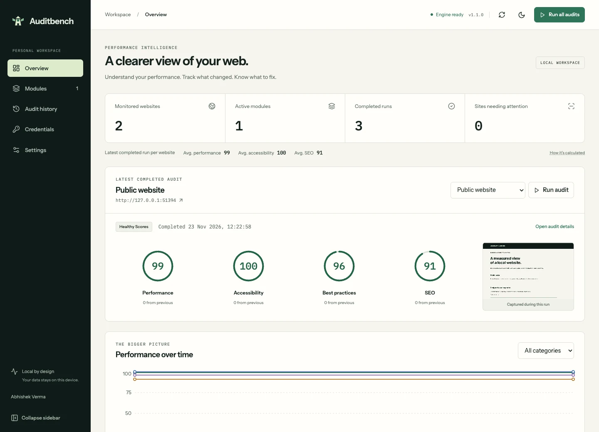

# Auditbench

A local-first performance intelligence workspace for developers and engineering teams. Understand your website's performance, track what changed, and know what to fix.



Run real Lighthouse audits from a focused Electron desktop application. Group websites into modules, audit signed-in pages, compare measured scores and investigate the original diagnostic findings. Reports, screenshots and history stay on your device.

## What you can do

- Create, rename, color, pause and delete modules; add, edit and organize websites.
- Audit a single page, a whole module or every active website with shared live progress.
- Review Performance, Accessibility, Best Practices and SEO scores. Historic PWA values are preserved in the database but are not requested or presented as current Lighthouse scoring.
- Compare real history, previous runs with matching audit profiles, exact timestamps and category trends.
- Search, filter and sort audit history; inspect failed runs, screenshots and full Lighthouse JSON reports.
- Save reusable or website-specific logins with OS-backed password protection in the desktop app.
- Choose light, dark or system appearance and configure a Chrome executable in Settings.

The overview calculates each category average from one latest completed run per website, excluding missing measurements. Counts and averages query the full database. The history workspace loads the newest 10,000 records and charts show up to 1,000 observed points; older records remain in SQLite. Performance below 90 in any supported category or a failed latest attempt marks a website as needing attention. Synthetic Lighthouse lab scores are not real-user monitoring.

## Install

Download the appropriate asset from [GitHub Releases](https://github.com/axvrma/auditbench/releases/latest): macOS Apple Silicon or Intel DMG, Windows x64, or Linux x64 AppImage. Auditbench 2.0.0 is the first release under the new name. **Google Chrome is required**; a custom Chrome/Chromium executable can be selected in Settings.

Windows releases provide a guided NSIS installer and a portable ZIP. For the ZIP, extract the entire archive before opening the application. On macOS, open the DMG and copy Auditbench into Applications. On Linux, make the AppImage executable and launch it; your distribution may require FUSE support.

Current installers are unsigned and macOS builds are not notarized. Check the source and release notes before responding to operating-system security prompts. Supported platform packaging is maintained in CI; actual verification in this change is limited to the macOS arm64 host described in [verification](docs/verification.md).

## Develop

Requires Node.js 24, npm and Google Chrome. Native SQLite builds may need your platform's C/C++ build tools.

```sh
npm ci
npm run dev
```

Open the Vite local URL (`http://127.0.0.1:5173`). The local API binds to `127.0.0.1:4001` and is proxied by Vite. Both servers stay local. `npm run dev` rebuilds SQLite for Node before starting the API.

For optional encrypted credential development, supply `LIGHTHOUSE_SECRET_KEY` from an external secret manager as a base64-encoded random 32-byte key. Without it, ordinary public-site audits work and secret writes remain disabled. Use an isolated `LIGHTHOUSE_DATA_DIR`; never store the key beside a database or reuse desktop production data for tests.

Launch the real desktop application:

```sh
npm start
```

Build and package without publishing:

```sh
npm run build
npm run package:desktop
```

The builder rebuilds native modules for the selected Electron runtime. See [release process](docs/release-process.md) for cross-platform commands, signing and the artifact matrix.

## Verify

```sh
npm run typecheck
npm test
npm run test:ui
npm run test:browser
npm run test:landing
npm run test:desktop
```

Browser scripts default to the normal Chrome application path on macOS; configure `CHROME_PATH` for another installed executable. They use temporary databases and real local fixture pages. `npm test` covers API CRUD, validation, secret redaction/migration, locked storage, restart recovery, failed audit status, scoring, screenshot references, download resolution and Netlify output. Browser checks cover real authenticated/single/batch audits, UI state/error recovery, themes, dialogs and responsive marketing layouts. Actual results and untested environments are in [verification](docs/verification.md).

## Architecture and local data

- `dashboard/`: React, strict TypeScript, Vite, Lucide and Recharts. One shared workspace provider owns audit polling and completion refresh.
- `server/`: Express, SQLite, Lighthouse and Puppeteer. HTTP(S) audit targets, controlled validation, persistent reports and one sequential audit queue.
- `desktop/main.mjs`: sandboxed Electron window, random loopback server, private session token, OS secret protection and native lifecycle/menu handling.
- `landing/`: separate lightweight static product website. Netlify never runs the local engine.

Desktop data stays under Electron's per-user `userData/audits` directory, retaining the existing v1.1.0 location. Browser development defaults to server/data.db and server/screenshots. `LIGHTHOUSE_DATA_DIR` can explicitly select a different directory. Back up the entire directory with the application closed. Upgrades never replace the database; interrupted runs become visible failures and completed history remains intact.

Existing plaintext passwords are converted only when secure storage is available, after creating an owner-only SQLite recovery backup. **That backup contains plaintext secrets.** A migration notice identifies it; remove it after verifying your saved logins. Unavailable OS storage locks authentication rather than falling back to plaintext. Encrypted passwords depend on the original OS key store. Read [security and migration](docs/security.md) before moving credential data between machines.

## Public website and Netlify

Netlify uses the committed netlify.toml to prepare and publish only landing-dist, including production and pull-request previews. Set SITE_URL for a custom canonical domain; Netlify's URL variables are otherwise used to generate SEO metadata, robots and sitemap files. Downloads resolve actual GitHub release assets and fall back to the official releases page. No paid Netlify service or backend is required.

```sh
SITE_URL=https://your-domain.example npm run build:landing
python3 -m http.server 8080 --bind 127.0.0.1 --directory landing-dist
```

See [deployment](docs/deployment.md), [architecture review](docs/architecture-review.md), [Electron architecture](docs/electron-architecture.md) and [design system](docs/design-system.md).

## Troubleshooting

- **Chrome missing:** install Chrome, then use Settings to select the actual executable (inside the app bundle on macOS).
- **Native module ABI mismatch:** `npm run rebuild:node` for development/tests; `npm run rebuild:desktop` for Electron. Do not rebuild both concurrently.
- **Authentication failed:** verify the login URL and selectors. MFA, captchas and arbitrary external SSO flows require manual investigation; the app fails conservatively instead of silently auditing a login page.
- **Secrets locked:** unlock the OS store and use the original application/user profile. Re-enter passwords if the original key store is lost. Linux `basic_text` protection is rejected.
- **Interrupted audit:** restart the engine; the attempt appears as failed and can be rerun.
- **Database cannot open:** close the app, preserve a copy of the data directory and inspect filesystem permissions or restore a known-good backup. The app never deletes a corrupted database to hide the error.
- **Downloads unavailable:** open official GitHub Releases; API rate limiting does not disable that fallback.

[Abhishek Verma](https://axvrma.com). [Source](https://github.com/axvrma/auditbench) · [Releases](https://github.com/axvrma/auditbench/releases/latest).
